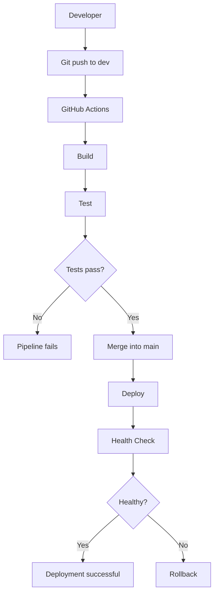
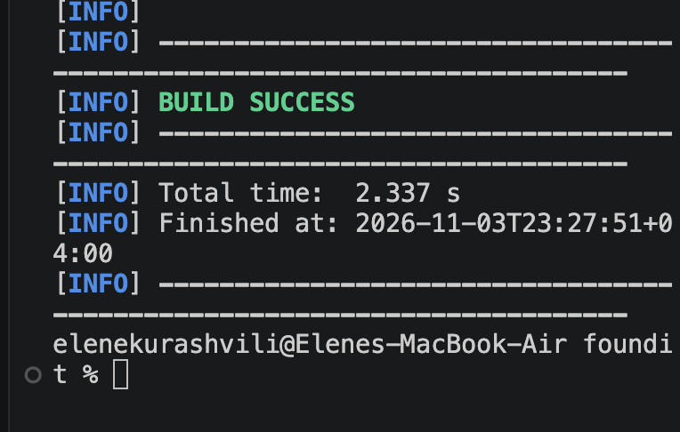
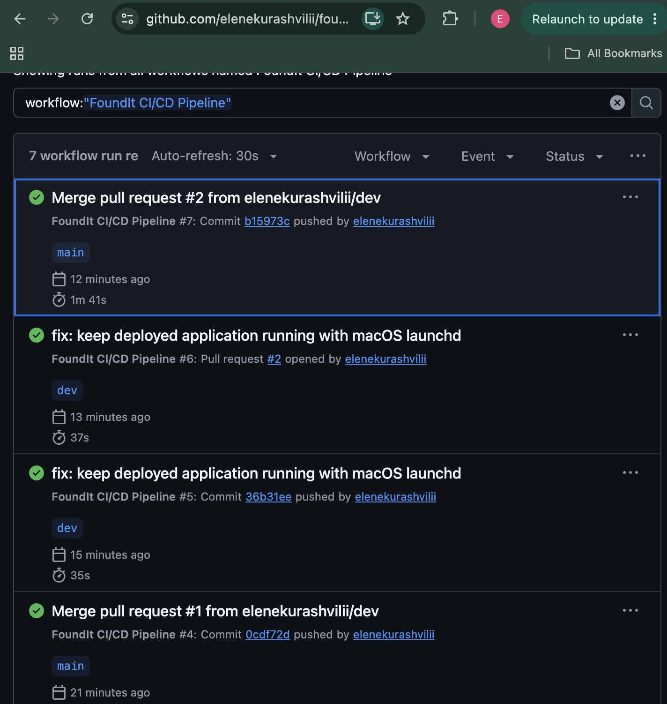

# FoundIt — Lost and Found Platform

FoundIt is a web application built with Java Spring Boot that helps people report, search for, and recover lost and found belongings.

## Technologies Used

- Java 21
- Spring Boot
- Maven
- Spring Web
- Thymeleaf
- HTML, CSS and JavaScript
- JUnit 5
- Git and GitHub
- GitHub Actions
- Shell scripting

## Features

- View lost and found items
- Search items by name and location
- Filter items by LOST and FOUND categories
- Report a lost or found item
- Mark an item as returned
- Delete items through the REST API
- Health-check endpoint

## REST API

| Method | Endpoint | Description |
|---|---|---|
| GET | `/api/items` | Get all items |
| GET | `/api/items?search=headphones` | Search items |
| GET | `/api/items?type=LOST` | Filter items |
| GET | `/api/items/{id}` | Get item by ID |
| POST | `/api/items` | Create an item |
| PUT | `/api/items/{id}/return` | Mark item as returned |
| DELETE | `/api/items/{id}` | Delete an item |
| GET | `/health` | Application health check |

## Run Locally

Requirements: Java 21 and Maven wrapper.

```bash
chmod +x mvnw
./mvnw spring-boot:run
```

Open http://localhost:8080

## Run Tests

```bash
./mvnw test
```

The project includes unit tests for the ItemService layer.

## Git Branching Strategy

The project uses two branches:

- `main` — stable production-ready code.
- `dev` — ongoing development and feature integration.

Development changes are committed to `dev` and merged into `main` through a Pull Request.

## CI/CD Pipeline

GitHub Actions automates the project workflow.

The pipeline contains three stages:

1. **Build** — compiles and packages the Spring Boot application.
2. **Test** — executes automated unit tests.
3. **Deploy** — deploys the application after successful build and test stages.

The pipeline is triggered by pushes and pull requests.

## Deployment Strategy

The application uses a Blue-Green-inspired deployment strategy with release directories and a `current` symlink. If the health check fails after deployment, the previous release is restored when available.

## Health Monitoring

The health-check script sends an HTTP request to `/health` and records the result with a timestamp in a `.log` file.

## Project Workflow



## Screenshots

### 1. FoundIt Application
The running FoundIt web application.


### 2. Successful Unit Tests
Automated unit tests executed successfully using Maven.



### 3. GitHub Actions CI/CD Pipeline
Successful Build, Test, and Deploy stages.



## Author

FoundIt — University DevOps Midterm Project.